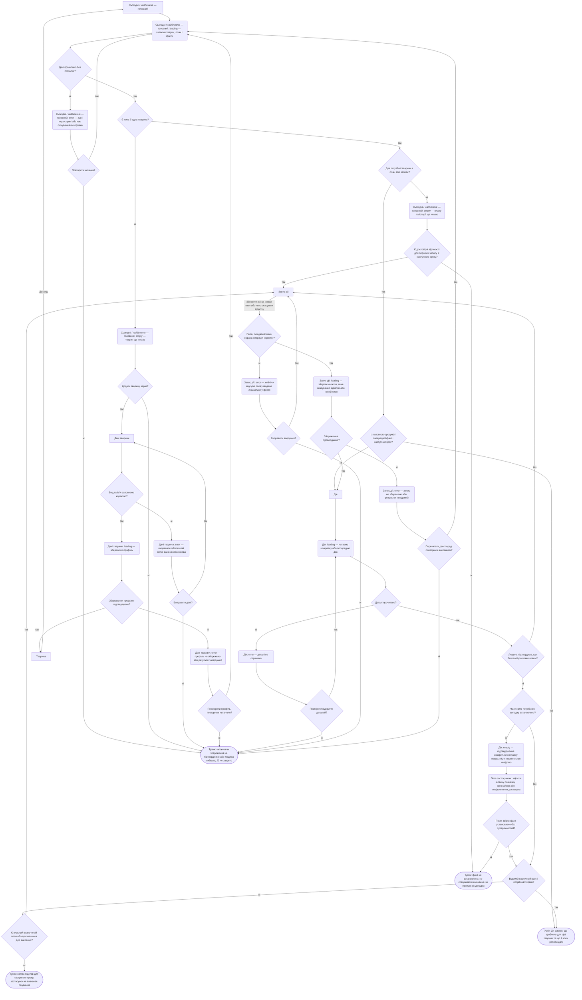
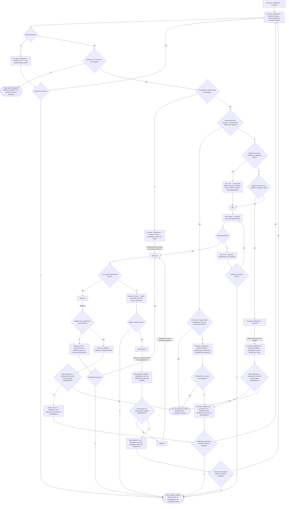
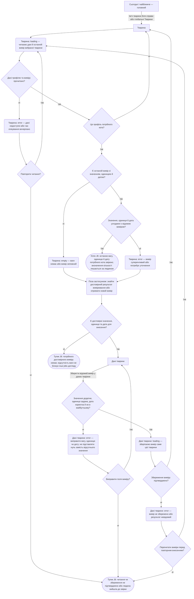

# User flows: догляд за котами й собаками

Проєктні сценарії за [JTBD](jtbd.md), [персонами](personas.md), [брифом](Codex.md) і [реєстром екранів](sitemap.md#екрани) цієї робочої копії. Це специфікація для прототипу, а не опис реалізованого застосунку. Тут сім flows: MAIN JOB і J1–J6. MAIN JOB, J1–J3 та J6 — для primary-персони **«Фіксує повторний догляд»**. J4 — для secondary **«Ділить догляд і передає історію»**, також стосується primary; J5 — для secondary **«Зводить справи кількох улюбленців»**. Обставини й критерій завершення наведено перед кожною діаграмою.

## Як читати діаграми

- Прямокутники `[...]` — екрани. Їхні назви дослівно взято із sitemap: **Сьогодні / найближче — головний**, **Дія**, **Запис дії**, **Тварина**, **Дані тварини**. Створення, редагування та перегляд різних записів — режими цих самих екранів.
- Ромби `{...}` — питання з виходами **так / ні**. Підписи решти стрілок пояснюють дію людини або перехід. Читання та завантаження не є додатковими натисканнями.
- Заокруглені вузли `(...)` — окремі стани з назвою екрана, якому вони належать, або явно позначена дія поза застосунком. Вузли `([...])` — кінцевий успіх чи тупик. Стани й кінці не є новими екранами.
- `empty` означає, що даних справді немає після успішного читання; `error` — що читання, введення або дія не вдалися. Збій читання не можна показувати як порожню історію. `loading` завершується відповіддю або помилкою/тайм-аутом, без нескінченного очікування.
- Після неоднозначної відповіді на збереження спершу перечитуємо дані, а не повторюємо запис навмання. Захист від дублів, збереження введеного після помилки та перевірка результату — **пропозиції для прототипу `[?]`**, не вже погоджена технічна реалізація. Якщо перевірка недоступна, успіх не показуємо.

Нових екранів не потрібно: усі використані назви вже є в `sitemap.md`. Системний запит дозволу Android, перевірка паперової позначки та розмова з доглядачем не стають маршрутами продукту. Нагадування необов’язкове; відсутність ваги теж не блокує основний догляд. J6 розгорнуто нижче: вагу звіряють на екрані **Тварина**, вносять через **Дані тварини**, як уже визначено в sitemap; калькулятора доз тут немає.

**Уточнення сигналів від засновниці:** є лише дві явні відмітки — «Готово» (факт «дали» для препарату) та «Пропустити». Обидві припиняють решту сигналів конкретного випадку. Окремого CTA чи статусу «ще не дали» немає: свайп/ігнорування не є відміткою. Кількість сигналів, включно з першим, та частоту/інтервал між ними користувач задає заздалегідь. Без відмітки сигнали йдуть за цим графіком до вичерпання кількості; після цього дія лишається «невідомо». Свайп не поновлює ліміт. Це окремо від повторення самої дії. [Підстава F4](research/notes/11-founder-weight-and-statuses-2026-11-11.md#f4-явний-пропуск-і-задана-користувачем-кількість-сигналів).

**Погоджене редагування від 12 листопада:** «Дія» → «Редагувати» → наявний «Запис дії». Помилкове «Готово» явно скасовують командою «Скасувати відмітку виконання» на тому самому випадку; хибна фактична дата/час прибирається, початковий план лишається. За запізнілого виконання редагують правильну фактичну дату/час, пояснення за бажанням пишуть у наявній нотатці. «Запланувати ще раз» на пропущеній картці відкриває створення нового майбутнього випадку в тому самому редакторі; старий лишається пропущеним зі стриманою текстовою позначкою. Зміна назви, часу чи нотатки сама не скасовує відмітку. [Підстава F5](research/notes/12-edit-correct-reschedule-2026-11-12.md).

### Спільні стани редакторів J0–J6

Ці переходи діють для «Запису дії» та «Даних тварини» на всіх входах, зокрема глобальних. Вони не є новими екранами й не потребують повторення повного підсценарію в кожному job.

| Стан / подія | Доступна дія й наступний стан |
| --- | --- |
| Глобально відкрито «Запис дії» | `loading` читання доступних тварин → готова форма, `empty` без тварин або `error` читання. Збій читання не показується як порожній список. |
| `empty`: жодної тварини немає | «Додати тварину» → «Дані тварини». Після підтвердженого збереження — «Тварина» → «Продовжити запис» → той самий «Запис дії» з відновленою чернеткою й вибраною новою твариною. Альтернатива — «Повернутися до догляду». Профіль не створюється повторно після неоднозначної відповіді: спершу перечитуються профілі. |
| Форма має незбережені зміни; обрано Back, інший таб/пункт або вихід із редактора | `loading` збереження чернетки. Після підтвердження — перехід до джерела або вибраного розділу. Чернетка не створює профіль, подію, вимір, відмітку чи сигнал. |
| `error`: чернетку не вдалося зберегти | Введене лишається у відкритій формі. «Залишитися у формі» повертає до редагування; «Відкинути зміни» потребує явного підтвердження й лише після нього дозволяє вийти. Без підтвердження введене не стирається. |
| Повторне відкриття редактора з чернеткою | Показати, до якого випадку й тварини вона належить. «Продовжити» відновлює поля; «Відкинути чернетку» очищує їх лише після явного вибору. Чернетка іншої тварини не підставляється мовчки. |
| Форма не змінювалася або зміни вже підтверджено збережені | Back і глобальна навігація спрацьовують без зайвого підтвердження. |

Чернетки розділяються за редактором, твариною та наявним випадком / наміром створення. Перед переходом у створення тварини запам’ятовуються джерело й введені дані запису. Після підтвердженого збереження самої форми очищується тільки її чернетка: успіх створення профілю не стирає чернетку дії. Стійкість після закриття процесу й технічний спосіб зберігання ще перевірятимуться; ці правила задають поведінку звичайного переходу між екранами. [Погоджене виправлення F6](research/notes/13-approved-flow-audit-fixes-2026-11-12.md).

## MAIN JOB · Знати, що вже зроблено і що потрібно зробити тепер

> Коли настає час знову подбати про здоров’я моєї тварини, я хочу знати, що вже було зроблено і що потрібно зробити тепер, щоб не пропустити потрібну дію та не повторити вже виконану.

**Обставини:** primary відкриває головний перед повторним доглядом або після сигналу. Потрібні ім’я тварини, останній факт, конкретний поточний випадок і наступний крок. «Усі / одна тварина» — фільтр головного, а не обов’язковий додатковий екран. Історія попередньої процедури не доводить виконання сьогоднішньої дози.

**Критерій закриття J0:** людина розрізняє відоме виконання, підтверджене невиконання або майбутній план і знає наступний крок та його термін, якщо термін потрібний. Це може бути зрозуміло одразу з головного — без відмітки й переходу. Якщо факт неможливо встановити або немає підстав для наступного плану, job не закрито. Фізичне виконання догляду не є обов’язковою умовою цього інформаційного job; запис виконання та перевірку дози розгорнуто в J1/J3 нижче.

**Розвилки й стани:**

- **Читання:** успішне завантаження веде до перевірки даних; `loading` → `error` при збої/тайм-ауті, далі повторення або вихід без висновку про історію. Деталі мають власну таку саму гілку.
- **Перший запуск:** `empty` без тварин → створення профілю або вихід. Хибні вид/ім’я дають `error`, їх можна виправити; `loading` збереження завершується підтвердженням або помилкою. Якщо відповідь неоднозначна, спершу перечитуємо профілі. Після успіху відкривається «Тварина», звідти — «Догляд», як у sitemap.
- **Порожній догляд:** відсутність плану й історії — окремий `empty`. Перший запис можливий лише з відомих людині даних. Порожня історія сама не дозволяє ні стверджувати невиконання, ні призначити наступний термін.
- **Достатність даних і корекція:** зрозумілий стан на головному одразу закриває job; інакше людина відкриває потрібну чи попередню «Дію». Підтверджене помилкове «Готово» веде через «Редагувати» у форму з явним «Скасувати відмітку виконання». Хибна фактична дата/час прибирається, початковий термін лишається; після терміну стан повертається до `невідомо`, до нього — до `заплановано`. Якщо факт не встановлено, `empty` веде до зовнішньої звірки; брак доказу лишається тупиком. Свідчення іншого випадку не підходить.
- **Наступний крок:** відомий факт і наступний крок → успіх. Коли терміну бракує, можна внести власний визначений план; якщо підстав для нього немає, це окремий тупик. Для пропущеної картки «Запланувати ще раз» відкриває створення нового майбутнього випадку, а не редагування її історичного пропуску. Застосунок не підставляє медичний графік.
- **Внесення:** неправильні значення → `error` із виправленням або виходом; збереження → `loading`, потім «Дія» із збереженим записом або `error`. Глобальне створення відкриває нову «Дію», редагування повертає до тієї, з якої відкрито форму. Для нового плану дата/час не в минулому; для відомого факту минула дата дозволена, майбутня — ні. Корекція не стирає початкового простроченого терміну. Перечитування має встановити, чи запис уже існує, перш ніж його додавати знову. Вихід до підтвердження не закриває job.

## J1 · Зберегти, що саме і коли фактично відбулося

> Коли я щойно провів обробку або відвідав ветеринара з твариною, я хочу зберегти, що саме і коли відбулося, щоб згодом відновити фактичну історію догляду.

**Чому обрано:** повторювана дія primary і джерело фактів для J0/J3. Саме її люди можуть забути позначити після догляду; це створює подальшу невизначеність. Це якісний пріоритет з JTBD, не виміряна частота.

**Основний шлях:** потрібну тварину вже створено; глобальний вхід без неї має окремий empty-перехід до створення профілю й повернення, тому передумова перевіряється. Факт виконання відомий людині. **Успіх:** збережено одну дію правильної тварини з фактичною датою/часом; для запланованого випадку припинено його сигнали. Збереження наступного плану — J2, воно не повинно блокувати запис факту.

**Розвилки й стани:**

- **Читання:** `loading` актуальних відміток → дані або `error`; повторити чи вийти. Передумова про наявну тварину не означає, що її дані завжди доступні.
- **Достовірність:** невідоме виконання закінчується тупиком J1 і потребує звірки J3. Уже збережений правильний факт закриває job без нового запису. Коли факт відомий, але його поля чи дата помилкові, «Дія» → «Редагувати» відкриває той самий запис для явного виправлення. Якщо самого виконання не було, «Скасувати відмітку виконання» розгорнуто в J3; нова копія задачі хибного факту не виправляє.
- **Наявна справа / `empty`:** наявний випадок можна відмітити на головному; за відсутності справи глобальний «Запис дії» відкриває створення. В останньому випадку «Дія» показується після збереження, як у sitemap.
- **Глобальний вхід без тварин:** передумова не приховує перевірку. Якщо тварини немає, `empty` редактора має «Додати тварину» та «Повернутися до догляду». Створення використовує «Дані тварини», помилки полів/збереження не втрачають чернетку. Після успіху через «Тварину» повертаємося в ту саму форму; після неоднозначної відповіді спершу перечитуємо профілі. Back і зміна розділу підпорядковуються спільним станам редакторів вище.
- **Момент виконання:** для щойно відомого факту «Готово» залишається одним натисканням. Для давнього виконання або додаткових полів — «Дія» → «Редагувати» → «Запис дії» з явною фактичною датою; поточний час її не замінює. За запізнення зберігаються початковий план і правильна фактична дата/час; причина за бажанням — у наявній нотатці, без нового спеціального поля. Ознака «із запізненням» похідна, стан лишається `виконано`.
- **Валідація:** помилкові поля дають `error`; людина виправляє їх або виходить без збереженого факту. Препарат і дозування необов’язкові, але введені значення мають бути коректними.
- **Запис і сигнали:** `loading` збереження → підтверджений факт і припинення сигналів або `error`. Для нового факту без нагадування перевірка припинення сигналів не потрібна. Якщо запис збережено, але припинення сигналів не підтверджено, факт не стираємо, нового виконання не створюємо; показуємо частковий збій і перечитуємо стан. Короткий успіх лишається на головному, форма повертається до джерела або показує «Дію» при глобальному створенні; вузол `success` позначає результат, а не примусовий перехід.

## J2 · Знати термін наступної регулярної дії заздалегідь

> Коли я планую наступну регулярну дію для тварини, я хочу знати її термін заздалегідь, щоб встигнути організувати її вчасно.

**Чому обрано:** другий бік повторного догляду primary. Збережений факт без майбутнього терміну не допомагає організувати наступну дію; у джерелах є окремий випадок забутого річного огляду. Нагадування допомагає, але відмова системи в дозволі не має приховувати збережений план.

**Основний шлях:** тварину вже створено; глобальний вхід без неї проходить явну перевірку й дозволяє створити профіль із поверненням до чернетки плану. **Успіх:** термін потрібної дії збережено й видно разом із твариною. Нагадування — додатковий результат з окремим підтвердженням; у тій самій формі людина задає загальну кількість сигналів і частоту/інтервал між ними. Раннє підготовче нагадування H1 залишається поза ядром MVP.

```mermaid
flowchart TD
    P_HOME["Сьогодні / найближче — головний"]
    P_LOAD("Сьогодні / найближче — головний: loading — читаємо план, попередній факт і доступних тварин")
    P_READ{"Дані прочитано?"}
    P_READ_ERROR("Сьогодні / найближче — головний: error — план недоступний")
    P_READ_RETRY{"Повторити читання?"}
    P_EXISTS{"Є потрібний майбутній план?"}
    P_EXISTING["Дія"]
    P_CORRECT{"Термін і тварина відповідають наміру?"}
    P_EMPTY("Сьогодні / найближче — головний: empty — потрібного плану немає")
    P_REUSE{"Є пропущена картка, яку власник хоче запланувати ще раз?"}
    P_SKIPPED["Дія"]
    P_EDIT["Запис дії"]
    P_HAS_PETS{"Є доступна тварина для плану?"}
    P_EDITOR_READY["Запис дії"]
    P_NO_PETS("Запис дії: empty — тварин ще немає; чернетку плану збережено")
    P_ADD_PET{"Додати тварину зараз?"}
    P_PET_FORM["Дані тварини"]
    P_PET_SAVE("Дані тварини: loading — перевіряємо поля та зберігаємо коректний профіль")
    P_PET_OK{"Поля коректні й збереження профілю підтверджено?"}
    P_PET_ERROR("Дані тварини: error — виправити поля або перевірити результат збереження")
    P_PET_RETRY{"Перечитати профілі перед наступною спробою?"}
    P_PET_VIEW["Тварина"]
    P_INTERVAL{"Власник явно обрав повторення через інтервал?"}
    P_BASE{"Є підтверджена фактична дата попереднього виконання?"}
    P_NO_BASE("Запис дії: empty — попереднього факту немає; потрібна перша майбутня дата, обраний інтервал зберігається")
    P_MANUAL{"Відома дата для ручного планування?"}
    P_DATE["Запис дії"]
    P_CALC("Запис дії: loading — фактична дата плюс заданий інтервал")
    P_CALCULATED{"Розрахунок дав коректний термін?"}
    P_CALC_ERROR("Запис дії: error — інтервал чи результат розрахунку некоректні")
    P_CALC_FIX{"Виправити інтервал або перейти до ручної дати?"}
    P_VALID{"Новий термін не в минулому, поля плану й параметри сигналів коректні?"}
    P_BAD("Запис дії: error — виправити план або параметри обраного нагадування")
    P_FIX{"Виправити введення?"}
    P_SAVE("Запис дії: loading — зберігаємо план")
    P_SAVED{"Збереження плану підтверджено?"}
    P_SAVE_ERROR("Запис дії: error — план не збережено або результат невідомий")
    P_VERIFY{"Перечитати план перед повторним внесенням?"}
    P_DETAIL["Дія"]
    P_WANT{"Людина обрала нагадування про цю дію?"}
    P_PERMISSION("Дія: loading — очікуємо відповідь системи про дозвіл на сповіщення")
    P_ALLOWED{"Дозвіл на сповіщення є?"}
    P_DENIED("Дія: error — сповіщення недоступні; термін збережено")
    P_SIGNAL("Дія: loading — реєструємо нагадування для цього випадку")
    P_SIGNAL_OK{"Реєстрацію нагадування підтверджено?"}
    P_SIGNAL_ERROR("Дія: error — реєстрація сигналу не підтверджена; план лишається")
    P_RETRY_SIGNAL{"Повторити реєстрацію нагадування?"}
    P_SUCCESS(["Успіх J2: термін відомий і збережений; нагадування налаштовано"])
    P_NO_SIGNAL(["Успіх J2 без сигналу: термін видно в застосунку; доставку не обіцяємо"])
    P_NO_DATE(["Тупик: немає фактичної бази чи власної наступної дати; план не вигадуємо"])
    P_STOP(["Тупик: план не підтверджено або людина припинила внесення"])

    P_HOME --> P_LOAD --> P_READ
    P_READ -->|ні| P_READ_ERROR --> P_READ_RETRY
    P_READ_RETRY -->|так| P_LOAD
    P_READ_RETRY -->|ні| P_STOP
    P_READ -->|так| P_EXISTS
    P_EXISTS -->|так| P_EXISTING --> P_CORRECT
    P_CORRECT -->|так| P_DETAIL
    P_CORRECT -->|ні| P_EDIT
    P_EXISTS -->|ні| P_EMPTY
    P_EMPTY --> P_REUSE
    P_REUSE -->|так| P_SKIPPED
    P_SKIPPED -->|Запланувати ще раз; новий випадок із підставленими твариною та назвою| P_EDIT
    P_REUSE -->|ні| P_EDIT
    P_EDIT --> P_HAS_PETS
    P_HAS_PETS -->|так| P_EDITOR_READY
    P_EDITOR_READY -->|Задати план і за бажанням кількість та частоту сигналів| P_INTERVAL
    P_HAS_PETS -->|ні| P_NO_PETS --> P_ADD_PET
    P_ADD_PET -->|ні| P_STOP
    P_ADD_PET -->|так| P_PET_FORM
    P_PET_FORM -->|Зберегти; некоректні поля не надсилаються| P_PET_SAVE --> P_PET_OK
    P_PET_OK -->|так| P_PET_VIEW
    P_PET_VIEW -->|Продовжити запис; відновити чернетку| P_EDIT
    P_PET_OK -->|ні| P_PET_ERROR --> P_PET_RETRY
    P_PET_RETRY -->|так| P_LOAD
    P_PET_RETRY -->|ні| P_STOP
    P_INTERVAL -->|так| P_BASE
    P_BASE -->|так| P_CALC --> P_CALCULATED
    P_BASE -->|ні| P_NO_BASE --> P_MANUAL
    P_INTERVAL -->|ні| P_MANUAL
    P_MANUAL -->|так| P_DATE
    P_DATE -->|Указати першу майбутню дату; зберегти явно обраний інтервал| P_VALID
    P_MANUAL -->|ні| P_NO_DATE
    P_CALCULATED -->|так| P_VALID
    P_CALCULATED -->|ні| P_CALC_ERROR --> P_CALC_FIX
    P_CALC_FIX -->|так| P_EDIT
    P_CALC_FIX -->|ні| P_STOP
    P_VALID -->|ні| P_BAD --> P_FIX
    P_FIX -->|так| P_EDIT
    P_FIX -->|ні| P_STOP
    P_VALID -->|так| P_SAVE --> P_SAVED
    P_SAVED -->|ні| P_SAVE_ERROR --> P_VERIFY
    P_VERIFY -->|так| P_LOAD
    P_VERIFY -->|ні| P_STOP
    P_SAVED -->|так| P_DETAIL
    P_DETAIL --> P_WANT
    P_WANT -->|ні| P_NO_SIGNAL
    P_WANT -->|так| P_PERMISSION --> P_ALLOWED
    P_ALLOWED -->|ні| P_DENIED --> P_NO_SIGNAL
    P_ALLOWED -->|так| P_SIGNAL --> P_SIGNAL_OK
    P_SIGNAL_OK -->|так| P_SUCCESS
    P_SIGNAL_OK -->|ні| P_SIGNAL_ERROR --> P_RETRY_SIGNAL
    P_RETRY_SIGNAL -->|так| P_SIGNAL
    P_RETRY_SIGNAL -->|ні| P_NO_SIGNAL
```

**Розвилки й стани:**

- **Читання й наявний план:** `loading` → план або `error` з повторенням/виходом. Відсутній потрібний план — `empty`, а не помилка; наявний правильний план не створюємо вдруге, неправильний відкриваємо на редагування. Якщо нового плану ще немає, з пропущеної картки можна обрати «Запланувати ще раз» або створити план глобальним «Записом дії». Обидва шляхи використовують наявний редактор.
- **План після пропуску:** «Запланувати ще раз» — режим створення нового випадку з підставленими твариною та назвою. Власник явно задає дату/час і перевіряє нагадування; історичний випадок лишається `пропущено`, без фактичної дати виконання та з припиненими сигналами. Якщо нового плану не створено, це стримана текстова позначка «Пропущено» в історії, а не постійна тривожна червона плашка чи нова помилка.
- **Глобальний вхід без тварин:** `empty` редактора має «Додати тварину» та «Повернутися до догляду». Введені назва, перша дата, інтервал і параметри сигналів зберігаються як чернетка; після створення профілю через «Дані тварини» й «Тварину» повертаємося до тієї самої форми. Збій читання профілів — `error`, а не порожній перелік. Для виходу з обох редакторів діє спільне правило чернетки.
- **Перша дата й правило повторення:** майбутню дату першого випадку та обраний інтервал можна зберегти разом навіть без історії виконань. Підтверджений факт потрібний для розрахунку наступного випадку після виконання, а не для збереження самого правила. За відсутності факту `empty` просить першу майбутню дату, зберігаючи обраний інтервал. Він застосовується тільки після першого «Готово» з фактичною датою. Стани «невідомо» й «пропущено», плановий термін та час сигналу не стають базою такого розрахунку. Якщо інтервал не обирали, ручна дата лишається разовим планом.
- **Розрахунок і введення:** `loading` розрахунку → коректний термін або `error`; можна виправити інтервал, обрати ручну дату або вийти. Для нового плану минулі дата/час недоступні: сьогодні можна обрати, якщо заданий час ще попереду; без часу — сьогодні або майбутній день. Це не заборона минулих фактичних дат J1 чи збереження первинного простроченого терміну при корекції. Для обраного нагадування кількість сигналів має бути цілим числом від одного; для кількох сигналів потрібний додатний інтервал між ними. Необране нагадування цих полів не вимагає. Відсутні чи хибні поля дають окремий `error` валідації. Інтервал повторення дії та частота сигналів — різні налаштування; жодне не є рекомендацією лікування.
- **Збереження:** `loading` → підтверджений план або `error`; за неоднозначної відповіді спочатку перечитуємо план. Немає підтвердження — немає успішного завершення внесення. Глобальне створення відкриває збережену «Дію»; редагування повертає до її контексту.
- **Необов’язковий сигнал:** без вибору нагадування J2 закрито видимим терміном. Із нагадуванням є `loading` системної відповіді й реєстрації; відмова в дозволі або збій дають `error` доступності сигналу, але не видаляють план. Після збою реєстрації можна повторити її без повторного створення дії або завершити без сигналу. Відмову в дозволі можна пізніше змінити в системних налаштуваннях Android; нового екрана продукту для них немає.
- **Межа гарантії:** реєстрація сигналу не доводить майбутню доставку. Розділення успішного запису плану та помилки нагадування — проєктна пропозиція `[?]` для перевірки; станів доставки як нових статусів сутності не вводимо.

**Після налаштування:**

| Задане користувачем правило / подія | Подальші сигнали цього випадку | Стан дії |
| --- | --- | --- |
| Один сигнал, його свайпнули чи проігнорували | Більше сигналів немає: задану кількість вичерпано | Після терміну — `невідомо` |
| Десять сигналів, після першого немає відмітки | Решта за початковим графіком, максимум десять загалом | `невідомо`, доки немає явної відмітки |
| Натиснуто «Готово» до вичерпання кількості | Решта скасовується | `виконано` з фактичною датою/часом |
| Натиснуто «Пропустити» до вичерпання кількості | Решта скасовується | `пропущено`, без фактичної дати виконання |
| Задану кількість вичерпано без відмітки | Нових сигналів немає; свайп не запускає їх заново | `невідомо`; позначку можна поставити пізніше в застосунку |

Числа один і десять — приклади правила, а не затверджені пресети. Наступний повтор дії має власний випадок і нагадування; завершення поточної серії сигналів не вимикає його.

## J3 · З’ясувати, чи конкретну дозу вже дали

> Коли настає час дати тварині препарат, я хочу з’ясувати, чи цю дозу вже дали, щоб не пропустити її й не повторити помилково.

**Чому обрано:** найризикованіший із вибраних jobs за наслідком помилки — у JTBD є свідчення повторної та пропущеної дози, а також забутої відмітки. Це не оцінка ймовірності помилки в нашому застосунку. Порожня клітинка й свайп сигналу не є доказами невиконання.

**Обставини:** primary після сигналу не пам’ятає, чи дала препарат. **Успіх звірки:** установлено факт саме цієї дози, тварини та випадку. У застосунку людина може підтвердити відоме виконання через «Готово» або явно обрати «Пропустити»; обидві відмітки припиняють решту сигналів цього випадку. Саме спостереження «ще не дали», свайп або закриття екрана не є CTA чи статусом і нічого не закривають у моделі дії. Застосунок показує записи людей, а не незалежне підтвердження фізичного виконання. Якщо факт не встановлено й явного пропуску немає, після терміну лишається «невідомо» з рештою сигналів за початковим налаштуванням.

```mermaid
flowchart TD
    D_HOME["Сьогодні / найближче — головний"]
    D_LOAD("Сьогодні / найближче — головний: loading — читаємо конкретний випадок дози")
    D_READ{"Дані прочитано?"}
    D_ERROR("Сьогодні / найближче — головний: error — стан дози недоступний")
    D_RETRY{"Повторити читання?"}
    D_PENDING{"Є незавершена операція відмітки або корекції?"}
    D_RESULT_LOAD("Дія: loading — читаємо результат операції, відмітку, сигнали та залежний план")
    D_RESULT_KNOWN{"Результат усіх потрібних частин операції відомий?"}
    D_RESULT_ERROR("Дія: error — результат операції невідомий; звичайна звірка ще недоступна")
    D_RESULT_RETRY{"Повторити перевірку результату?"}
    D_ALL_DONE{"Усі потрібні частини операції підтверджено?"}
    D_INCOMPLETE("Дія: error — лишилися непідтверджені кроки; збережений факт не повторюємо")
    D_RETRY_STEPS{"Завершити лише непідтверджені кроки?"}
    D_STEPS_LOAD("Дія: loading — завершуємо лише потрібні сигнали або залежний план без нового факту")
    D_STEPS_OK{"Решту кроків операції підтверджено завершено?"}
    D_FOUND{"Є запис саме цієї дози та тварини?"}
    D_EMPTY("Сьогодні / найближче — головний: empty — потрібного випадку не знайдено")
    D_VISIBLE{"На головному є несуперечливе підтвердження виконання цієї дози?"}
    D_DETAIL["Дія"]
    D_DETAIL_LOAD("Дія: loading — читаємо фактичну дату, препарат і стан")
    D_DETAIL_OK{"Деталі прочитано?"}
    D_DETAIL_ERROR("Дія: error — запис не отримано або він недоступний")
    D_DETAIL_RETRY{"Повторити читання деталей?"}
    D_DONE{"Є несуперечливий факт виконання саме цього випадку?"}
    D_ALREADY_SKIPPED{"Є несуперечлива явна відмітка Пропустити для цього випадку?"}
    D_CONFLICT{"Відмітка суперечить власному спостереженню чи іншому джерелу?"}
    D_UNKNOWN("Дія: empty — підтвердження виконання немає; після терміну стан невідомо")
    D_EXTERNAL("Поза застосунком: звірити власну позначку, органайзер або уточнити в доглядача")
    D_GIVEN{"Достовірно встановлено, що саме цю дозу дали?"}
    D_JUST_NOW{"Є запис цього випадку, виконано щойно й поля коректні?"}
    D_QUICK["Дія"]
    D_QUICK_LOAD("Дія: loading — зберігаємо Готово з фактичним часом і припиняємо решту сигналів")
    D_CHOOSE_SKIP{"Людина вирішила явно пропустити цей випадок?"}
    D_SKIP_EXISTS{"Конкретний випадок уже є в плані?"}
    D_SKIP_SCREEN["Дія"]
    D_SKIP_LOAD("Дія: loading — зберігаємо явний пропуск і припиняємо решту сигналів")
    D_SKIP_CANCEL("Дія: loading — перевіряємо припинення решти сигналів уже збереженого пропуску")
    D_SKIP_OK{"Пропуск і припинення решти сигналів підтверджено?"}
    D_SKIP_ERROR("Дія: error — пропуск або припинення сигналів не підтверджено")
    D_SKIP_RETRY{"Перечитати відмітку й стан сигналів?"}
    D_REPAIR_FORM["Запис дії"]
    D_CANCEL_CHOICE{"Користувач явно обрав Скасувати відмітку виконання?"}
    D_CANCEL_LOAD("Запис дії: loading — прибираємо хибний факт і перевіряємо залежний наступний план без дублів")
    D_CANCEL_OK{"Скасування відмітки й узгодження залежного плану підтверджено?"}
    D_CANCEL_ERROR("Запис дії: error — результат корекції або залежний план не підтверджено")
    D_CANCEL_RETRY{"Перечитати результат перед повторною спробою?"}
    D_RECORD{"Записати відомий факт зараз?"}
    D_EDIT["Запис дії"]
    D_VALID{"Тварина, конкретний випадок і фактична дата коректні?"}
    D_BAD("Запис дії: error — хибні дані підтвердження")
    D_FIX{"Виправити дані?"}
    D_SAVE("Запис дії: loading — зберігаємо підтвердження без повторного виконання")
    D_SAVED{"Факт збережено й припинення сигналів цього випадку підтверджено?"}
    D_SAVE_ERROR("Запис дії: error — результат запису або припинення сигналів не підтверджено")
    D_VERIFY{"Перечитати стан перед повторним внесенням?"}
    D_YES(["Успіх J3: відомо, що цю дозу дали; повторне виконання не потрібне"])
    D_SKIP_SUCCESS(["Випадок явно позначено пропущеним; решту його сигналів припинено, фактичної дати виконання немає"])
    D_NO_CASE(["Тупик: немає конкретного випадку для відмітки; спершу потрібний запис дії"])
    D_UNSAVED(["J3 з’ясовано поза застосунком, але факт не збережено: тупик для майбутньої звірки"])
    D_STOP(["Тупик: стан недоступний; не підміняти його припущенням про дозу"])
    D_UNCLEAR(["Тупик J3: явної відмітки немає; після терміну невідомо, решта сигналів лише в межах заданого ліміту"])
    D_CONTRADICTION("Дія: error — суперечлива відмітка; відкрити явну корекцію наявного випадку")
    D_UNRESOLVED(["Тупик J3: факт або потребу корекції не підтверджено; запис не змінено"])

    D_HOME --> D_LOAD --> D_READ
    D_READ -->|ні| D_ERROR --> D_RETRY
    D_RETRY -->|так| D_LOAD
    D_RETRY -->|ні| D_STOP
    D_READ -->|так| D_PENDING
    D_PENDING -->|ні| D_FOUND
    D_PENDING -->|так| D_RESULT_LOAD --> D_RESULT_KNOWN
    D_RESULT_KNOWN -->|ні| D_RESULT_ERROR --> D_RESULT_RETRY
    D_RESULT_RETRY -->|так| D_RESULT_LOAD
    D_RESULT_RETRY -->|ні| D_STOP
    D_RESULT_KNOWN -->|так| D_ALL_DONE
    D_ALL_DONE -->|так| D_FOUND
    D_ALL_DONE -->|ні| D_INCOMPLETE --> D_RETRY_STEPS
    D_RETRY_STEPS -->|ні| D_STOP
    D_RETRY_STEPS -->|так| D_STEPS_LOAD --> D_STEPS_OK
    D_STEPS_OK -->|так| D_FOUND
    D_STEPS_OK -->|ні| D_INCOMPLETE
    D_FOUND -->|ні| D_EMPTY --> D_CHOOSE_SKIP
    D_FOUND -->|так| D_VISIBLE
    D_VISIBLE -->|так| D_YES
    D_VISIBLE -->|ні| D_DETAIL
    D_DETAIL --> D_DETAIL_LOAD --> D_DETAIL_OK
    D_DETAIL_OK -->|ні| D_DETAIL_ERROR --> D_DETAIL_RETRY
    D_DETAIL_RETRY -->|так| D_DETAIL_LOAD
    D_DETAIL_RETRY -->|ні| D_STOP
    D_DETAIL_OK -->|так| D_DONE
    D_DONE -->|так| D_YES
    D_DONE -->|ні| D_ALREADY_SKIPPED
    D_ALREADY_SKIPPED -->|так| D_SKIP_CANCEL --> D_SKIP_OK
    D_ALREADY_SKIPPED -->|ні| D_CONFLICT
    D_CONFLICT -->|так| D_CONTRADICTION
    D_CONTRADICTION -->|Редагувати| D_REPAIR_FORM --> D_CANCEL_CHOICE
    D_CANCEL_CHOICE -->|ні| D_UNRESOLVED
    D_CANCEL_CHOICE -->|так| D_CANCEL_LOAD --> D_CANCEL_OK
    D_CANCEL_OK -->|так| D_LOAD
    D_CANCEL_OK -->|ні| D_CANCEL_ERROR --> D_CANCEL_RETRY
    D_CANCEL_RETRY -->|так| D_LOAD
    D_CANCEL_RETRY -->|ні| D_STOP
    D_CONFLICT -->|ні| D_UNKNOWN --> D_CHOOSE_SKIP
    D_EXTERNAL --> D_GIVEN
    D_GIVEN -->|так| D_JUST_NOW
    D_JUST_NOW -->|так| D_QUICK
    D_QUICK -->|Готово в деталях поточного випадку| D_QUICK_LOAD --> D_SAVED
    D_JUST_NOW -->|ні| D_RECORD
    D_GIVEN -->|ні| D_UNCLEAR
    D_CHOOSE_SKIP -->|ні| D_EXTERNAL
    D_CHOOSE_SKIP -->|так| D_SKIP_EXISTS
    D_SKIP_EXISTS -->|ні| D_NO_CASE
    D_SKIP_EXISTS -->|так| D_SKIP_SCREEN
    D_SKIP_SCREEN -->|Пропустити| D_SKIP_LOAD --> D_SKIP_OK
    D_SKIP_OK -->|так| D_SKIP_SUCCESS
    D_SKIP_OK -->|ні| D_SKIP_ERROR --> D_SKIP_RETRY
    D_SKIP_RETRY -->|так| D_LOAD
    D_SKIP_RETRY -->|ні| D_STOP
    D_RECORD -->|ні| D_UNSAVED
    D_RECORD -->|так| D_EDIT
    D_EDIT -->|Указати відому фактичну дату, Зберегти| D_VALID
    D_VALID -->|ні| D_BAD --> D_FIX
    D_FIX -->|так| D_EDIT
    D_FIX -->|ні| D_UNSAVED
    D_VALID -->|так| D_SAVE --> D_SAVED
    D_SAVED -->|так| D_YES
    D_SAVED -->|ні| D_SAVE_ERROR --> D_VERIFY
    D_VERIFY -->|так| D_LOAD
    D_VERIFY -->|ні| D_UNSAVED
```

**Розвилки й стани:**

- **Доступність:** головний і «Дія» мають окремі `loading` та `error`; після помилки можна перечитати або вийти в тупик. Помилка не перетворюється на висновок «не дали».
- **Відновлення часткової операції:** до запису зберігається контекст того, що треба підтвердити: відмітку, припинення сигналів і, для корекції, залежний наступний план. Після тайм-ауту, повторного входу чи повернення з іншого розділу звичайна звірка й `D_YES` недоступні, доки цей контекст не перевірено. `loading` результату завершується відомим станом або `error` з повторною перевіркою/поверненням до догляду. Якщо частина операції вже збережена, повторюються лише непідтверджені кроки; нове виконання, пропуск чи наступний випадок не створюються. Контекст закривається лише після підтвердження всіх потрібних частин. Це стан операції, а не п’ятий статус дії.
- **Потрібний випадок:** відсутній запис — `empty` головного; відсутнє підтвердження в наявному записі — `empty` деталей. Збіг препарату без збігу тварини та конкретного випадку не закриває job. Запис попереднього виконання — лише контекст.
- **Достовірність і корекція:** несуперечливе підтвердження на головному одразу дає успіх; інакше відкриваються деталі. Суперечливе «Готово» веде через «Редагувати» в наявний «Запис дії»; явне «Скасувати відмітку виконання» прибирає хибну фактичну дату/час зі збереженням первинного плану. Редагування назви, часу чи нотатки без цієї команди саме відмітки не скасовує. Якщо потрібне лише уточнення дати реального виконання, її виправляють як відомий факт за J1, зберігаючи `виконано`.
- **Збереження корекції:** окреме `loading` завершується підтвердженням або `error`. Потрібно узгодити залежний автоматичний наступний план без дублів і мовчазної втрати ручних змін. За неоднозначної відповіді спершу перечитуємо результат. Після успіху знову читаємо стан того самого випадку: до терміну — `заплановано`, після його настання — `невідомо`. Це не `пропущено` й не новий випадок. Скасування не відтворює минулі сигнали та не поновлює вичерпану кількість. Непідтверджений факт, відмова від корекції або збій лишаються тупиками; самої відсутності команди виправлення серед них більше немає.
- **Зовнішня звірка:** перевіряється факт виконання саме цієї дози. Відповідь «не знайшов доказу виконання» не доводить пропуску. Окремого CTA чи статусу «ще не дали» немає. Без підтвердження або явного вибору «Пропустити» стан після терміну лишається `невідомо`; рішення про препарат застосунок не приймає.
- **Підтвердження відомого виконання:** можна внести знайдений факт з реальною датою без повторної фізичної дії. Для наявного запису шлях до форми — «Дія» → «Редагувати»; коли запису немає — глобальний «Запис дії». Збереження має `loading`, хибне введення й невдале збереження — окремі `error`, із виправленням або перевіркою результату перед повтором.
- **Короткий шлях primary:** після звірки щойно відомого виконання «Готово» доступне на тій самій «Дії», без редактора: відкрити деталі — 1 натискання, підтвердити — 2; попередній вибір іншої тварини додає 1, разом максимум 3. Умовні ромби та читання не є додатковими натисканнями. Для давнього факту або зміни полів зберігається редактор із реальною фактичною датою, а не підставленим поточним часом.
- **Явний пропуск:** людина відкриває конкретну «Дію» й натискає «Пропустити»; на головному доступна та сама відмітка без відкриття деталей. `loading` має завершитися підтвердженням збереженого пропуску й припинення решти сигналів або `error`. За часткового збою перечитуємо відмітку й повторюємо лише непідтверджене припинення сигналів, а не створюємо новий пропуск. Фактичної дати виконання немає. Після «Запланувати ще раз» нові майбутні дата/час і сигнали належать новому випадку за J2; первинний пропуск не переписується.
- **Кінці:** підтверджене виконання або явно зафіксований пропуск завершують поточний випадок і припиняють решту його сигналів. Якщо людина свайпнула сигнал чи вийшла без вибору, це не нова відмітка: продовжується тільки початково задана решта сигналів, а після вичерпання кількості стан без відповіді все одно `невідомо`. Якщо факт з’ясовано, але не збережено, інформаційний J3 може бути з’ясований для людини, проте застосунок і майбутня звірка лишаються без цього підтвердження.

## J4 · Відновити назви препаратів і дати для ветеринара

> Коли ветеринар питає про минуле лікування моєї тварини, я хочу швидко відновити назви препаратів і точні дати, щоб передати йому правильну історію.

**Персона й обставини:** «Ділить догляд і передає історію» (secondary), також «Фіксує повторний догляд» (primary). На прийомі людина не може згадати назву препарату або фактичну дату та відкриває історію конкретної тварини. **Причина окремого flow:** тут недостатньо знати найближчий термін — потрібні правильні минулі відомості для іншої людини.

**Успіх J4:** ветеринар отримав потрібні назви й фактичні дати саме цієї тварини — людина показала запис на телефоні або повідомила відомості. Завантаження історії саме по собі не є передачею. Неповний запис не видається за повну історію. Показ/передача вкладеного документа лишається після ядра MVP; цей flow обходиться записами та зовнішньою звіркою з оригіналом без його завантаження.

```mermaid
flowchart TD
    V_HOME["Сьогодні / найближче — головний"]
    V_PET["Тварина"]
    V_LOAD("Тварина: loading — читаємо історію вибраної тварини")
    V_READ{"Історію прочитано без помилки?"}
    V_ERROR("Тварина: error — історія недоступна або час очікування вичерпано")
    V_RETRY{"Повторити читання історії?"}
    V_RIGHT{"Вибрана саме та тварина, про яку питає ветеринар?"}
    V_FOUND{"Є потрібні записи про минуле лікування?"}
    V_EMPTY("Тварина: empty — потрібних записів немає; це не доказ відсутності лікування")
    V_DETAIL["Дія"]
    V_DETAIL_LOAD("Дія: loading — читаємо препарат, фактичну дату й належність запису")
    V_DETAIL_READ{"Деталі запису прочитано?"}
    V_DETAIL_ERROR("Дія: error — деталі не отримано")
    V_DETAIL_RETRY{"Повторити читання деталей?"}
    V_COMPLETE{"Є потрібна назва препарату й несуперечлива фактична дата?"}
    V_MISSING("Дія: empty — потрібних відомостей бракує або їх треба уточнити")
    V_SOURCE("Поза застосунком: звірити потрібні назви й дати з оригінальними записами")
    V_PROOF{"Потрібні відомості встановлено достовірно?"}
    V_WANT_SAVE{"Зберегти уточнені відомості в застосунку зараз?"}
    V_EDIT["Запис дії"]
    V_VALID{"Тварина, назва препарату й фактична дата введені коректно?"}
    V_BAD("Запис дії: error — виправити поля; планова дата не замінює фактичну")
    V_FIX{"Виправити введене?"}
    V_SAVE("Запис дії: loading — зберігаємо відомий факт або доповнюємо його поля")
    V_SAVED{"Збереження відомостей підтверджено?"}
    V_SAVE_ERROR("Запис дії: error — результат збереження не підтверджено")
    V_VERIFY{"Перечитати історію перед повторним внесенням?"}
    V_PARTIAL("Запис дії: error — відомості звірено, але не збережено; їх можна передати з оригіналу")
    V_MORE{"Потрібно перевірити ще один запис для цього запиту?"}
    V_SHOW("Поза застосунком: показати ветеринару перевірені записи або повідомити назви й фактичні дати")
    V_RECEIVED{"Ветеринар отримав потрібні відомості?"}
    V_SHOW_AGAIN{"Повторити показ або пояснення?"}
    V_SUCCESS(["Успіх J4: ветеринар отримав потрібні назви препаратів і фактичні дати цієї тварини"])
    V_UNKNOWN(["Тупик J4: потрібні відомості не встановлено; повідомити, що історія неповна"])
    V_STOP(["Тупик J4: дані чи їх збереження недоступні або людина вийшла до передачі"])
    V_NOT_SENT(["Тупик J4: записи знайдено, але потрібні відомості ветеринару не передано"])

    V_HOME -->|Ім’я тварини або глобальні Тварини| V_PET
    V_PET --> V_LOAD --> V_READ
    V_READ -->|ні| V_ERROR --> V_RETRY
    V_RETRY -->|так| V_LOAD
    V_RETRY -->|ні| V_STOP
    V_READ -->|так| V_RIGHT
    V_RIGHT -->|ні| V_PET
    V_RIGHT -->|так| V_FOUND
    V_FOUND -->|ні| V_EMPTY --> V_SOURCE
    V_FOUND -->|так| V_DETAIL
    V_DETAIL --> V_DETAIL_LOAD --> V_DETAIL_READ
    V_DETAIL_READ -->|ні| V_DETAIL_ERROR --> V_DETAIL_RETRY
    V_DETAIL_RETRY -->|так| V_DETAIL_LOAD
    V_DETAIL_RETRY -->|ні| V_STOP
    V_DETAIL_READ -->|так| V_COMPLETE
    V_COMPLETE -->|ні| V_MISSING --> V_SOURCE
    V_COMPLETE -->|так| V_MORE
    V_SOURCE --> V_PROOF
    V_PROOF -->|ні| V_UNKNOWN
    V_PROOF -->|так| V_WANT_SAVE
    V_WANT_SAVE -->|так| V_EDIT
    V_WANT_SAVE -->|ні| V_MORE
    V_EDIT -->|Зберегти встановлений факт| V_VALID
    V_VALID -->|ні| V_BAD --> V_FIX
    V_FIX -->|так| V_EDIT
    V_FIX -->|ні| V_PARTIAL
    V_VALID -->|так| V_SAVE --> V_SAVED
    V_SAVED -->|так| V_DETAIL
    V_SAVED -->|ні| V_SAVE_ERROR --> V_VERIFY
    V_VERIFY -->|так| V_LOAD
    V_VERIFY -->|ні| V_PARTIAL
    V_PARTIAL --> V_MORE
    V_MORE -->|так| V_PET
    V_MORE -->|ні| V_SHOW --> V_RECEIVED
    V_RECEIVED -->|так| V_SUCCESS
    V_RECEIVED -->|ні| V_SHOW_AGAIN
    V_SHOW_AGAIN -->|так| V_SHOW
    V_SHOW_AGAIN -->|ні| V_NOT_SENT
```

**Розвилки й стани:**

- **Тварина й доступність:** після вибору профілю — `loading`, потім дані або `error` із повторенням/виходом. Якщо вибрано не ту тварину, людина змінює її у перемикачі того самого екрана. Статус «історії немає» можливий лише після успішного читання, а не після збою.
- **Повнота:** відсутні записи — `empty` профілю; відсутня назва, фактична дата або суперечливі відомості — окремий стан уточнення на «Дії». Сама відсутність необов’язкової назви препарату не є помилкою збереження, але заважає відповісти на цей запит ветеринара. Дата покупки, запланована дата та наступний термін не підставляються як дата лікування.
- **Зовнішнє джерело:** якщо точні відомості є в оригіналі, людина може передати їх без внесення або за бажанням записати відомий факт за J1 / доповнити поля наявного фактичного запису. Для нового запису відкриває глобальний «Запис дії», для наявного — «Дія» → «Редагувати». Це не автоматичне перетворення плану чи стану `невідомо` на виконання. Без достовірного джерела — тупик із чесно позначеною неповнотою історії.
- **Внесення:** неправильні поля дають `error`, їх можна виправити або припинити внесення. `loading` збереження веде до «Дії» з підтвердженим записом або до `error`. За неоднозначної відповіді перечитуємо історію, перш ніж додавати запис знову; у цьому проході перевіряємо, чи вже з’явилися доповнені відомості.
- **Кілька записів:** наступний потрібний запис відкривається з історії того самого профілю. Критерій повноти — запит ветеринара, а не обов’язковий перегляд усієї історії тварини.
- **Передача:** перегляд не дорівнює завершенню job. Показ/усне повідомлення може не завершитися; тоді людина повторює його або виходить у тупик «не передано». Спільний акаунт, експорт та електронне надсилання цим flow не додаються.
- **Частковий результат запису:** якщо відомості вже звірено поза застосунком, але записати їх не вдалося чи людина відмовилася від внесення, діаграма дозволяє перейти до передачі з оригіналу. Це може закрити J4, але не підтверджує збереження в застосунку. Непідтверджений запис не має блокувати передачу вже відомих відомостей ветеринару.

## J5 · Отримати доступ до історії кожної тварини

> Коли я маю кількох тварин, я хочу мати доступ до історії кожної, щоб не втратити відомості, потрібні для її догляду.

**Персона й обставини:** «Зводить справи кількох улюбленців» (secondary). Людина веде кілька тварин, зокрема може мати кота й собаку, і повертається до потрібної історії. **Причина окремого flow:** доступ до першого профілю не доводить доступності решти; зміна тварини має змінювати всю історію без змішування записів.

**Успіх J5 у поточній сесії:** людина відкрила потрібні збережені історії всіх тварин, до яких збиралася звернутися, й може прочитати потрібні записи. Порожній новий профіль — лише підготовка, а не відновлена історія. Доступ після зміни телефона, резервне копіювання й відновлення ще не спроєктовані; успішне читання зараз не доводить збереження даних назавжди.

```mermaid
flowchart TD
    H_HOME["Сьогодні / найближче — головний"]
    H_PET["Тварина"]
    H_PROFILES("Тварина: loading — читаємо доступні профілі для перемикача")
    H_PROFILES_OK{"Профілі прочитано?"}
    H_PROFILES_ERROR("Тварина: error — профілі недоступні або час очікування вичерпано")
    H_PROFILES_RETRY{"Повторити читання профілів?"}
    H_EXISTS{"Потрібна тварина є в перемикачі?"}
    H_NO_PET("Тварина: empty — потрібного профілю в отриманому переліку немає")
    H_WAS_PET{"Ця тварина вже була внесена раніше?"}
    H_LOST_PET("Тварина: error — раніше внесений профіль не знайдено; причину ще не встановлено")
    H_ADD{"Додати нову тварину зараз?"}
    H_EDIT["Дані тварини"]
    H_VALID{"Вид та ім’я заповнено коректно?"}
    H_BAD("Дані тварини: error — виправити вид або ім’я; вага необов’язкова")
    H_FIX{"Виправити дані профілю?"}
    H_SAVE("Дані тварини: loading — зберігаємо новий профіль")
    H_SAVED{"Створення профілю підтверджено?"}
    H_SAVE_ERROR("Дані тварини: error — результат створення профілю невідомий або збереження не вдалося")
    H_VERIFY{"Перечитати профілі перед повторним створенням?"}
    H_SELECT["Тварина"]
    H_HISTORY("Тварина: loading — читаємо історію вибраної тварини")
    H_HISTORY_OK{"Історію прочитано й вона належить вибраній тварині?"}
    H_HISTORY_ERROR("Тварина: error — історія недоступна або її належність не підтверджено")
    H_HISTORY_RETRY{"Повторити читання історії цієї тварини?"}
    H_RECORDS{"Є збережені записи?"}
    H_EMPTY("Тварина: empty — історія порожня після успішного читання")
    H_WAS_HISTORY{"Людина очікує раніше збережені записи цієї тварини?"}
    H_LOST_HISTORY("Тварина: error — очікувані записи не знайдено; не вважати їх видаленими без перевірки")
    H_DETAIL["Дія"]
    H_DETAIL_LOAD("Дія: loading — відкриваємо потрібний запис цієї тварини")
    H_DETAIL_OK{"Запис доступний і належить цій тварині?"}
    H_DETAIL_ERROR("Дія: error — запис недоступний або належність не підтверджено")
    H_DETAIL_RETRY{"Повторити відкриття запису?"}
    H_MORE{"Потрібна історія ще однієї тварини?"}
    H_SUCCESS(["Успіх J5 у цій сесії: потрібні історії всіх вибраних тварин доступні без змішування записів"])
    H_PREP("Тварина: empty — профіль доступний, але історії ще немає")
    H_WRITE_FIRST{"Записати першу дію?"}
    H_RECORD["Запис дії"]
    H_J1_HANDOFF(["Перехід до J1: форму першого запису відкрито для вибраної тварини; J5 ще не закрито"])
    H_RESTORE("Тварина: error — очікуваний профіль чи записи недоступні; це не доказ видалення")
    H_RECHECK{"Повторно перевірити профіль і доступ?"}
    H_BACKUP_LOAD("Тварина: loading — перевіряємо доступність резервної копії для цієї тварини")
    H_BACKUP_KNOWN{"Перевірка копії завершилася без помилки?"}
    H_BACKUP_ERROR("Тварина: error — доступність копії не підтверджено")
    H_BACKUP_RETRY{"Повторити перевірку копії?"}
    H_HAS_BACKUP{"Є доступна підтверджена копія?"}
    H_NO_BACKUP("Тварина: empty — доступної копії немає; дані не відновлено")
    H_CONFIRM_RESTORE{"Відновити недоступні записи цієї тварини з копії?"}
    H_RESTORE_LOAD("Тварина: loading — відновлюємо потрібні записи без заміни новіших даних та інших тварин")
    H_RESTORE_OK{"Відновлення підтверджено без конфлікту даних?"}
    H_RESTORE_ERROR("Тварина: error — відновлення не підтверджено або є конфлікт; копію повторно не застосовуємо навмання")
    H_RESTORE_RETRY{"Перечитати профілі й результат відновлення?"}
    H_OTHER{"Переглянути іншу тварину?"}
    H_STOP(["Тупик J5: доступ не підтверджено або людина припинила спробу до перегляду всіх потрібних історій"])

    H_HOME -->|Глобальні Тварини| H_PET
    H_PET --> H_PROFILES --> H_PROFILES_OK
    H_PROFILES_OK -->|ні| H_PROFILES_ERROR --> H_PROFILES_RETRY
    H_PROFILES_RETRY -->|так| H_PROFILES
    H_PROFILES_RETRY -->|ні| H_STOP
    H_PROFILES_OK -->|так| H_EXISTS
    H_EXISTS -->|ні| H_NO_PET --> H_WAS_PET
    H_WAS_PET -->|так| H_LOST_PET --> H_RESTORE
    H_WAS_PET -->|ні| H_ADD
    H_ADD -->|ні| H_STOP
    H_ADD -->|так| H_EDIT
    H_EDIT -->|Зберегти нову тварину| H_VALID
    H_VALID -->|ні| H_BAD --> H_FIX
    H_FIX -->|так| H_EDIT
    H_FIX -->|ні| H_STOP
    H_VALID -->|так| H_SAVE --> H_SAVED
    H_SAVED -->|так| H_SELECT
    H_SAVED -->|ні| H_SAVE_ERROR --> H_VERIFY
    H_VERIFY -->|так| H_PROFILES
    H_VERIFY -->|ні| H_STOP
    H_EXISTS -->|так| H_SELECT
    H_SELECT -->|Вибрати потрібне ім’я в тому самому перемикачі| H_HISTORY
    H_HISTORY --> H_HISTORY_OK
    H_HISTORY_OK -->|ні| H_HISTORY_ERROR --> H_HISTORY_RETRY
    H_HISTORY_RETRY -->|так| H_HISTORY
    H_HISTORY_RETRY -->|ні| H_STOP
    H_HISTORY_OK -->|так| H_RECORDS
    H_RECORDS -->|ні| H_EMPTY --> H_WAS_HISTORY
    H_WAS_HISTORY -->|так| H_LOST_HISTORY --> H_RESTORE
    H_WAS_HISTORY -->|ні| H_PREP
    H_PREP --> H_WRITE_FIRST
    H_WRITE_FIRST -->|так| H_RECORD --> H_J1_HANDOFF
    H_WRITE_FIRST -->|ні| H_OTHER
    H_RESTORE --> H_RECHECK
    H_RECHECK -->|так| H_PROFILES
    H_RECHECK -->|ні| H_BACKUP_LOAD --> H_BACKUP_KNOWN
    H_BACKUP_KNOWN -->|ні| H_BACKUP_ERROR --> H_BACKUP_RETRY
    H_BACKUP_RETRY -->|так| H_BACKUP_LOAD
    H_BACKUP_RETRY -->|ні| H_OTHER
    H_BACKUP_KNOWN -->|так| H_HAS_BACKUP
    H_HAS_BACKUP -->|ні| H_NO_BACKUP --> H_OTHER
    H_HAS_BACKUP -->|так| H_CONFIRM_RESTORE
    H_CONFIRM_RESTORE -->|ні| H_OTHER
    H_CONFIRM_RESTORE -->|так| H_RESTORE_LOAD --> H_RESTORE_OK
    H_RESTORE_OK -->|так| H_PROFILES
    H_RESTORE_OK -->|ні| H_RESTORE_ERROR --> H_RESTORE_RETRY
    H_RESTORE_RETRY -->|так| H_PROFILES
    H_RESTORE_RETRY -->|ні| H_OTHER
    H_OTHER -->|так| H_PET
    H_OTHER -->|ні| H_HOME
    H_RECORDS -->|так| H_DETAIL
    H_DETAIL --> H_DETAIL_LOAD --> H_DETAIL_OK
    H_DETAIL_OK -->|ні| H_DETAIL_ERROR --> H_DETAIL_RETRY
    H_DETAIL_RETRY -->|так| H_DETAIL_LOAD
    H_DETAIL_RETRY -->|ні| H_STOP
    H_DETAIL_OK -->|так| H_MORE
    H_MORE -->|так| H_PET
    H_MORE -->|ні| H_SUCCESS
```

**Розвилки й стани:**

- **Перелік профілів:** `loading` → доступний перемикач або `error`, потім повторення чи вихід. Перемикач — частина «Тварини», окремого екрана списку немає. Вага, документи та запис другої тварини не є умовами відкриття першої історії.
- **Профіль не знайдено:** це `empty` отриманого переліку, після якого уточнюється очікування людини. Нову тварину можна додати через «Дані тварини»; раніше внесений зниклий профіль дає `error` доступності й тупик відновлення. Створення дубля не вважаємо відновленням старої історії.
- **Новий профіль:** хибні обов’язкові поля дають `error` із виправленням/виходом. `loading` збереження закінчується підтвердженням або `error`; за неоднозначної відповіді спершу перечитуємо профілі, не створюємо тварину повторно навмання. Збереження повертає до «Тварини», де можна вибрати її контекст.
- **Ізоляція історій:** після кожного вибору — `loading` потрібної історії. Поки читання не завершено й належність не підтверджено, дані попередньої тварини не показуються як поточні. Недоступна або помилково прив’язана історія дає `error`, а не `empty`.
- **Порожня історія:** якщо записів ніколи не було, `empty` має «Записати першу дію» → наявний «Запис дії» з вибраною твариною й передачею до J1. Це відкриття форми, а не закритий J5. Можна також вибрати іншу тварину або повернутися до догляду.
- **Недоступні очікувані дані:** `error` має повторну перевірку профілю/доступу та шлях перевірки резервної копії. Якщо підтверджена копія доступна, власник явно погоджує відновлення недоступних записів; `loading` завершується підтвердженням або `error`. Після підтвердження профілі й історія читаються заново, перед успіхом знову перевіряється належність тварині. Конфлікт не перезаписує новіші доступні записи чи дані іншої тварини. За неоднозначної відповіді спочатку перечитуємо результат, а не застосовуємо копію вдруге навмання.
- **Копії немає або відновлення не вдалося:** це чесний стан «Дані не відновлено», а не успіх. Доступні повторна перевірка, інша тварина та «Повернутися до догляду». Не пропонуємо створити дубль профілю як відновлення. Провайдера, формат копій і технічну реалізацію ще треба визначити; кнопка відновлення доступна лише за справді доступної копії. Сценарій не гарантує відновлення даних, яких немає в жодному доступному джерелі.
- **Конкретний запис:** його відкриття має власні `loading`/`error`, перевірку належності та повторення/вихід. Звідси «Назад» повертає до історії вибраної тварини; іншу обирають у тому самому профілі. Уже виявлений збій хоча б однієї потрібної історії не підміняється загальним успіхом для всіх.
- **Завершення:** успіх можливий після доступу до всіх історій, які людина хотіла переглянути в цій сесії. Вихід раніше — частковий доступ, а не закритий J5; створення профілю без історії — підготовка. Гарантії довготривалого зберігання цей flow не доводить.

## J6 · Звірити останню вагу й дату перед визначенням кількості препарату

> Коли я готуюся дати коту препарат, кількість якого залежить від ваги, я хочу знати його останню виміряну вагу й дату вимірювання, щоб визначити потрібну кількість за інструкцією до конкретного препарату або призначенням ветеринара.

**Персона й обставини:** «Фіксує повторний догляд» (primary). Перед визначенням кількості препарату для свого кота людина звертається до виміру в його профілі. **Причина окремого flow:** є пряма згадка потреби засновницею; поширеність для інших людей і собак не встановлена. Це не обов’язковий крок перед кожною дією догляду.

**Успіх J6:** людина звірила значення, одиницю й дату останнього збереженого виміру саме цього кота, може зіставити їх зі своїм джерелом для визначення кількості. «Останній» визначається датою вимірювання, а не часом редагування профілю. Застосунок не встановлює універсальний строк придатності ваги й не рахує дозу. Якщо потрібного виміру немає, він може бути внесений через ті самі «Дані тварини».

**Розвилки й стани:**

- **Доступність і тварина:** перехід із головного відкриває «Тварину». `loading` має завершитися даними або `error` з повторенням/виходом; відсутність відповіді не означає відсутності ваги. Якщо відкрито не того кота, людина змінює вибір у тому самому перемикачі, після чого дані читаються заново.
- **Наявність виміру:** порожній або неповний вимір — `empty`, а не нульова вага чи автоматична сьогоднішня дата. Доступний повний вимір можна одразу звірити, без форми та без нового зважування. Число без одиниці й дати не закриває J6.
- **Достовірність:** суперечливі значення потребують уточнення й мають окремий `error` стан. Давня дата сама по собі не є помилкою або автоматичною забороною: у брифі немає універсального строку актуальності. Коли людина в контексті своєї інструкції чи призначення потребує нового виміру, вона використовує шлях уточнення; застосунок цього медичного рішення не приймає.
- **Джерело:** відомий результат або нове вимірювання дозволяють внести дані через «Тварина» → «Змінити дані» → «Дані тварини». Без достовірного виміру — тупик саме J6; профіль, запис факту й перегляд інших справ залишаються доступними. Нового екрана зважування чи окремого екрана ваги немає.
- **Валідація:** нечислове/недодатне значення, відсутня одиниця, неможлива чи майбутня дата дають `error`, а не мовчазне збереження. Людина виправляє поля або виходить. Ці перевірки стосуються внесення виміру для J6: залишити всю необов’язкову групу ваги порожньою для інших задач дозволено. Медичних діапазонів і довільного строку актуальності не задаємо.
- **Збереження й повторна звірка:** `loading` збереження → підтвердження або `error`. За неоднозначної відповіді спершу перечитуємо виміри, не додаємо їх повторно навмання. Після успіху — назад у «Тварину», де знову звіряються показані значення, одиниця й дата; якщо внесено давніший вимір, він не стає останнім лише через час внесення.
- **Межа завершення:** успіх — звірена вага, а не призначена чи обчислена кількість препарату. За потреби визначене людиною дозування потім вноситься у наявному «Записі дії»; дія може посилатися на використаний вимір. Нове зважування не змінює минулі дози чи посилання на їхні історичні виміри. Правила корекції помилкового виміру, на який уже посилається дія, ще потребують уточнення `[?]`.

## Погоджені рішення та межі перевірки

- **Корекція й новий план погоджені F5:** «Редагувати» → явне «Скасувати відмітку виконання» виправляє хибне «Готово» на тому самому випадку; запізнілий факт редагується зі збереженням планового терміну й необов’язковою нотаткою. «Запланувати ще раз» після пропуску створює окремий майбутній випадок, залишаючи первинний пропуск зі стриманою текстовою позначкою. Ці правила більше не є відкритими питаннями. Новий план не рахується автоматично як після виконання з `невідомо` або `пропущено`. Повне редагування серій і окрема операція скасування помилкового «Пропустити» цим рішенням не додані.
- **Надійність:** атомарність запису, захист від дублів, збереження введеного, відновлення після тайм-ауту та підтвердження припинення сигналів потребують технічного рішення. Стрілка «перечитати» — вимога до перевірки результату, а не твердження про наявну синхронізацію. Спосіб входу, резервного копіювання й відновлення даних ще відкритий у брифі.
- **Межі перевірки:** частоту jobs, зручність головного без переходів, відмітку за одне натискання та здатність primary відрізнити порожній стан від невідомого факту потрібно перевірити на прототипі. Рендер Mermaid перевіряє діаграми, а не роботу Android-сповіщень чи медичну достовірність записів.
